# Methodology: QSGD and LLZ-p compression of federated model updates

Current-stage methods chapter, 25 September 2026. This describes implemented
behavior. Planned extensions are separated in the [experimental design](experimental-design.md).
Literature citations use the keys in [references.bib](references.bib).

## Study objective and contribution

The study evaluates incremental compression: after QSGD has discretized a
client update, how much can LLZ-p reduce its representation, and what additional
distortion does it introduce? The present contribution is an auditable
implementation and controlled empirical comparison, not a new quantizer or a
new convergence theorem. The [literature review](literature-review.md) motivates
this question and compares relevant alternatives.

The experiment uses four simulated clients for 100-way closed-set synthetic
facial identity classification. A fixed DigiFace subset contains 3,000 training,
1,000 validation, and 1,000 reserved test images. Each client has 750 training
and 250 validation examples. Identities are shared across splits; images are
disjoint. This evaluates classification of known identities, not verification
or identification of previously unseen people.

## Model and training

An ImageNet-initialized ResNet-18 prefix through layer3 remains frozen. Its
float32 spatial outputs are cached for original and horizontally flipped views.
Clients train layer4 and a 512-to-100 linear classifier, totaling 8,445,028
trainable parameters. All methods begin with the same pretrained layer4 and
the same previously validation-selected classifier. The cache accelerates the
experiment but is not itself federated model training.

Each round uses all four clients, one local epoch of SGD, batch size 16,
layer4 learning rate 0.003, and classifier learning rate 0.03. Momentum and
weight decay are absent, and rates remain fixed for 15 rounds. BatchNorm affine
parameters train, but its running statistics and counters remain fixed. Training
randomness and codec randomness have separate deterministic seeds. Complete
settings, data provenance, and initialization hashes appear in the protocol.

## Federated update definition

Let w_t be the server's trainable state at round t and w_local(k,t) the state
after client k's local epoch. Define the transmitted update before compression as

```text
delta(k,t) = w_local(k,t) - w_t
weight(k) = n_k / sum_j n_j
w_(t+1) = w_t + sum_k weight(k) * reconstructed_delta(k,t)
```

The compressed methods use this update rule. The uncompressed control sends
full local states and uses weighted model averaging. These constructions are
algebraically equivalent without compression, but floating-point operation
order can differ. Exact equality is required between QSGD and QSGD+LLZ p=0,
not between quantized and uncompressed training.

The 15 fixed BatchNorm buffers are verified at clients and restored by the
server. Compressed packets contain the non-fixed tensors; full-state uploads
in the control and all downloads contain the buffers. Client aggregation order
is fixed by dataset partition ID, removing arrival-order differences from the
lossless replay comparison.

## Two-stage codec

For each tensor, QSGD computes an L2 norm r and stochastically rounds normalized
coordinate magnitudes into signed integers q_i in [-s,s], where project s is
`levels`. Reconstruction is `r*q_i/s`. The reference setting is s=127. This is
the interval count; the supplied revised LLZ manuscript names the corresponding
parameter s+1. The original quantizer and its assumptions are discussed under
`alistarh2017qsgd` in the literature review.

Our QSGD-only packet densely packs each sign/magnitude code, with norm, shape,
and dtype metadata. The composed method encodes the already sampled codes with
LLZ-p, retaining that reconstruction metadata. It does not draw another random
quantization. The standalone modules depend on NumPy and the standard library;
the separate Flower/PyTorch adapter handles model states and messages.

LLZ-p searches the last 128 reconstructed symbols for a longest match whose
coordinate differences are each at most p. It emits a relative position,
length, and following literal, then updates reconstructed history. References
cannot overlap the pending source, and every phrase includes a literal. Equal
length matches select the largest relative position, matching the revised
algorithm's last-match overwrite under its documented interpretation. Each
tensor starts a fresh dictionary.

At p=0, decoded symbols equal the QSGD codes. At p>0, the additional error is
bounded in symbol units but need not be unbiased. For m changed coordinates,
the additional real-valued squared error before final dtype rounding is bounded
by `m*(p*r/s)^2`. The same integer tolerance can therefore have different effects
across tensors. Full framing, boundary behavior, and the reconstructed-history
notation ambiguity are documented in the [paper-to-code audit](llz-paper-audit.md).

```mermaid
flowchart LR
    A[Common server model] --> B[Local SGD epoch]
    B --> C[Trainable model delta]
    C --> D[QSGD symbols and norm]
    D --> E[Dense QSGD or LLZ-p packet]
    E --> F[Flower client reply]
    F --> G[Decode and dequantize]
    G --> H[Weighted delta aggregation]
    H --> I[Restore fixed buffers]
    I --> J[Validation and checkpoint selection]
```



No error feedback, cross-round dictionary, LLZ-SI, sparse Top-k transport,
adaptive tolerance, or compressed downlink is present in this study.

## Outcomes and correctness evidence

Checkpoints minimize validation cross-entropy loss, with the earliest round
winning exact ties. Accuracy refers to that checkpoint unless explicitly
labeled final-round accuracy. The test split remains unevaluated. Communication
totals cover all 15 rounds, regardless of when the selected checkpoint occurs.

The lossless comparison checks matching configuration/provenance, per-round
model hashes and learning metrics, and selected checkpoint metadata. Standalone
tests additionally compare integer codes and reconstructed floating bytes. The
72-test audit found no blocking codec defect under the stated interpretation;
it is not author certification or a formal proof of optimizer convergence.

QSGD error is measured relative to the original local delta. LLZ error is
measured relative to the dequantized QSGD delta. Per-round squared errors and
reference norms are summed across tensors and clients before division. These
ratios use different denominators and cannot be added.

The message ledger measures logical serialized Flower objects at the server
boundary. It includes packet and message metadata, counting each recipient
separately. Training uploads, training downloads, validation uploads, and
validation downloads are distinct categories. The protocol excludes transport
headers, runtime-control traffic, cache distribution, and earlier warm-start
training. It is not a network capture. Dedicated encoder/decoder timing is
specified but not yet implemented, so this study makes no measured speedup claim.

## Reproducibility and artifact handoff

The [protocol's provenance section](experimental-design.md#8-reproducibility-and-provenance)
records the exact study path, source and manifest fingerprints, initial-model
hash, and dependency versions. The saved application snapshot is authoritative
for replay; the current working tree has subsequent reporting/documentation
changes and some uncommitted implementation files.

To inspect existing evidence, open the study's `summary.json`, `study.json`,
`report/runs.csv`, and `report/curves.csv`. Per-run directories contain
configuration/metadata, history, communication observations, and checkpoints.
The source audit has its own file hashes and JUnit record under
`outputs/llz-paper-audit/`. Neither output directory is included in Git.

To regenerate plots from the completed study, without training:

```powershell
.venv\Scripts\python.exe -m flower_face.report outputs\finetune-compression-seed42\compression-study-20260925T091315807360Z
```

The protocol separately gives the command for a new reference experiment; it
must not be used merely to refresh a report. A fresh checkout requires the local
dataset, verified feature cache, pretrained weights, and warm-start checkpoint.
Absolute paths in local manifests/configurations need deliberate relocation and
provenance checks. Installing code alone does not reconstruct these artifacts.
This package therefore documents reproducibility requirements, not a claim that
all data and trained artifacts are publicly bundled.
